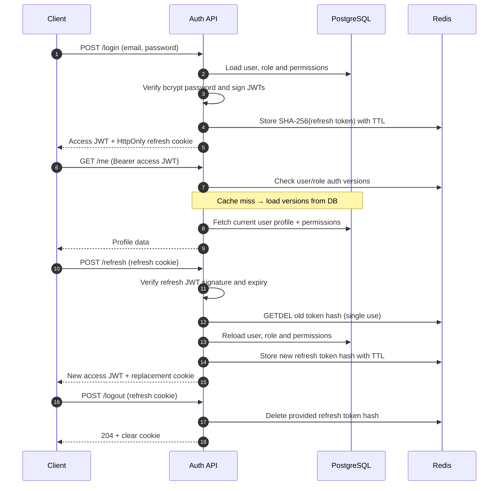

# Authentication Feature

JWT-based authentication for the Dashboard Backend, with PostgreSQL user
accounts and Redis-backed refresh sessions. This module handles identity and
session lifecycle; permission management is documented separately under
`features/rbac`.

## At a glance

- **Access tokens:** Short-lived JWTs returned in JSON and sent as
  `Authorization: Bearer <token>`.
- **Refresh tokens:** Longer-lived JWTs delivered in an `HttpOnly` cookie. Redis
  stores only their SHA-256 hashes with an expiration time.
- **Refresh rotation:** Each successful refresh atomically consumes the previous
  token and issues a new access/refresh pair.
- **Revocation:** Access tokens carry user/role authorization versions, checked
  by authentication middleware against Redis (with PostgreSQL fallback).
- **Security:** Passwords are hashed with `bcrypt` (cost 10); login failures do
  not reveal whether the email exists.

## API Reference

Base URL: **`/api/v1/auth`**

| Method | Endpoint    | Authentication          | Behavior                                                         | Success |
| ------ | ----------- | ----------------------- | ---------------------------------------------------------------- | ------- |
| `POST` | `/register` | Public                  | Creates an account with the configured default role              | `201`   |
| `POST` | `/login`    | Public                  | Checks credentials, returns access token and sets refresh cookie | `200`   |
| `POST` | `/refresh`  | Refresh cookie          | Rotates refresh token, returns a new access token                | `200`   |
| `GET`  | `/me`       | Bearer access token     | Returns the current user's profile, role and role permissions    | `200`   |
| `POST` | `/logout`   | Optional refresh cookie | Deletes the supplied refresh session and clears the cookie       | `204`   |

### Request and Response Examples

**Register** — `POST /api/v1/auth/register`

```json
{
  "name": "Alex Doe",
  "email": "alex@example.com",
  "password": "SecurePass123!"
}
```

`name` is optional (minimum 2 characters when provided); `email` must be valid;
`password` must have at least 8 characters.

Returns a `message` and `data` object containing the created user's `id`,
`name`, `email`, `role` (`id`, `name`) and timestamps.

The password is never returned. Registration **does not log the user in**.

**Login** — `POST /api/v1/auth/login`

```json
{
  "email": "alex@example.com",
  "password": "SecurePass123!"
}
```

Successful response:

```json
{
  "message": "User logged in successfully",
  "data": {
    "accessToken": "<JWT>"
  }
}
```

Also sets `Set-Cookie: refreshToken=...; HttpOnly; SameSite=Strict` (`Secure` in
production).

**Refresh** — `POST /api/v1/auth/refresh`

No JSON body is required. Send the refresh cookie.

Returns:

```json
{
  "data": {
    "accessToken": "<new JWT>"
  }
}
```

The response also replaces the refresh cookie.

**Current User** — `GET /api/v1/auth/me`

Requires `Authorization: Bearer <accessToken>`.

```json
{
  "data": {
    "id": "<uuid>",
    "name": "Alex Doe",
    "email": "alex@example.com",
    "role": "USER",
    "permissions": ["example:read"],
    "createdAt": "<ISO timestamp>",
    "updatedAt": "<ISO timestamp>"
  }
}
```

The role and permissions are read from the database. Permission names shown here
are illustrative; actual values depend on role configuration.

**Logout** — `POST /api/v1/auth/logout`

Send the refresh cookie. Returns no body and clears the cookie.

Logout revokes the **supplied refresh token**; an already issued access token
can remain usable until expiry or explicit authorization-version revocation.

## Session Lifecycle



### How Authorization Freshness Works

An access JWT contains:

- `userId`
- `roleId`
- `role`
- `permissions`
- `roleVersion`
- `userVersion`

The `authenticate` middleware validates its signature and expiry, then compares
its version values with Redis-cached values (falling back to PostgreSQL on cache
misses).

Mismatches return `401`, preventing outdated tokens from being accepted after
relevant version changes.

Permissions are still enforced by separate authorization middleware on protected
endpoints.

## Errors and Edge Cases

| Scenario                                                        | Expected Status |
| --------------------------------------------------------------- | --------------- |
| Invalid registration/login payload                              | `400`           |
| Registration with an existing email                             | `409`           |
| Invalid email/password combination                              | `401`           |
| Missing, invalid, expired or previously consumed refresh cookie | `401`           |
| Missing/invalid/expired/revoked Bearer token on `/me`           | `401`           |
| User missing when fetching `/me`                                | `404`           |
| Unconfigured default role or unexpected internal failure        | `500`           |

Errors use:

```json
{
  "status": "error",
  "message": "..."
}
```

Validation errors also include an `errors` array.

## Manual Test Checklist

Use Postman, Insomnia or curl with cookie persistence enabled. Start PostgreSQL
and Redis first.

- [ ] **Register:** Valid payload → `201`; returned data has no password;
      assigned role matches `DEFAULT_USER_ROLE`.
- [ ] **Validation:** Invalid email, short password or short optional name →
      `400`.
- [ ] **Duplicate account:** Register with the same email → `409`.
- [ ] **Login:** Correct credentials → `200`, access token in JSON and
      `refreshToken` cookie; incorrect credentials → `401`.
- [ ] **Protected route:** `/me` with valid Bearer token → `200` with role and
      permissions; without token → `401`.
- [ ] **Refresh:** Valid cookie → `200`, new access token and cookie; reuse
      previous cookie → `401`.
- [ ] **Refresh expiry:** Expired or forged refresh token → `401`.
- [ ] **Logout:** Call with current refresh cookie → `204`; subsequent refresh
      with that token → `401`. Repeating logout still returns `204`.
- [ ] **Revocation:** After changing a user's or role's `authVersion` through
      the proper application flow, the previous access token → `401`.
- [ ] **Concurrency:** Two simultaneous refresh attempts with the same cookie →
      only one succeeds (Redis `GETDEL`).

> **Testing status:** These are manual scenarios to execute, not an automated
> test suite. The current `npm test` script is a placeholder.

## Configuration and Source Files

Required environment variables for this feature (set values in your local
`.env`):

```dotenv
DATABASE_URL=postgresql://...
REDIS_URL=redis://localhost:6379
DEFAULT_USER_ROLE=USER
JWT_ACCESS_SECRET=<strong-secret>
JWT_ACCESS_EXPIRES_IN=15m
JWT_REFRESH_SECRET=<different-strong-secret>
JWT_REFRESH_EXPIRES_IN_SECONDS=604800
```

The TTLs above are examples, not hardcoded application defaults.

`DEFAULT_USER_ROLE` must exist in the database. Run the project's normal
database migrations and seeding before testing.

| File                                   | Responsibility                                                       |
| -------------------------------------- | -------------------------------------------------------------------- |
| `auth.route.ts`                        | Endpoint definitions and validation/authentication middleware        |
| `auth.controller.ts`                   | HTTP responses and refresh-token cookie handling                     |
| `auth.service.ts`                      | Registration, credential checks, profile lookup and session rotation |
| `auth.schema.ts`                       | Zod validation schemas                                               |
| `../../utils/jwt.ts`                   | Sign/verify access and refresh JWTs                                  |
| `../../utils/refreshToken.ts`          | Hash/store/consume/delete Redis refresh sessions                     |
| `../../middlewares/auth.middleware.ts` | Validate access JWTs and check authorization versions                |

**Implementation note:** `SameSite=Strict` is configured for the refresh cookie;
cross-site frontend deployments may require an intentional cookie/CORS policy
change. Keep refresh tokens out of JavaScript-accessible storage.
