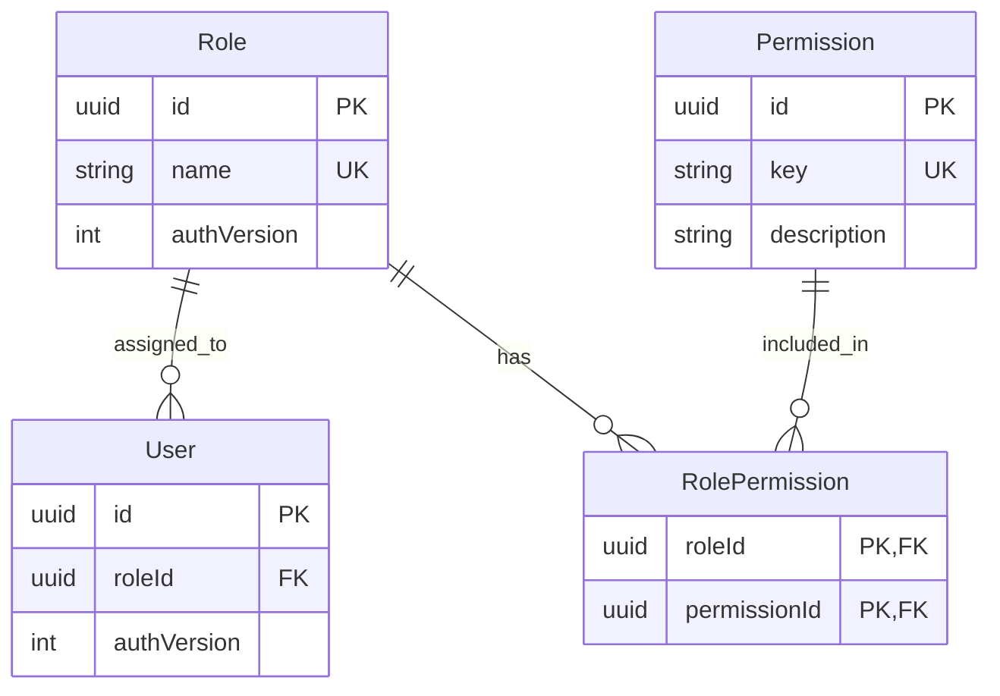
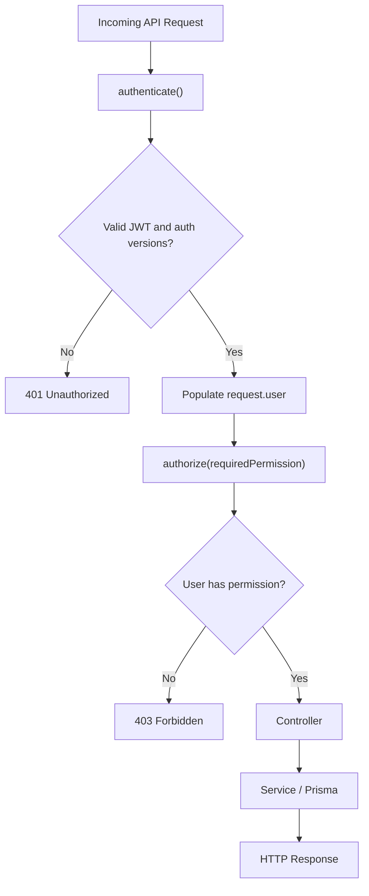
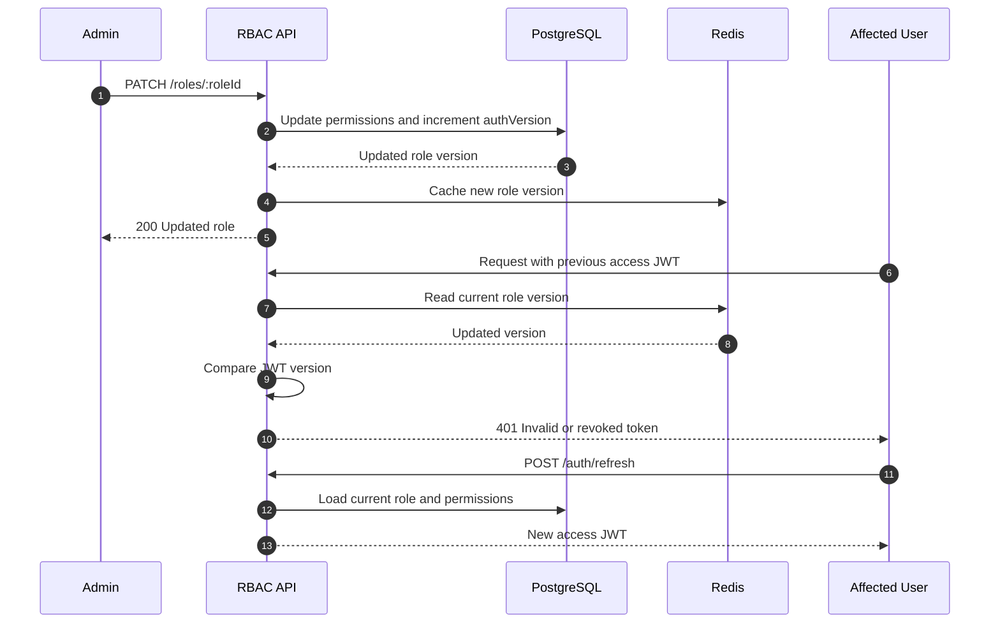

# Role-Based Access Control (RBAC)

Database-driven Role-Based Access Control for the Dashboard Backend, built with
Express.js, Prisma, PostgreSQL and Redis.

The module provides centralized permission enforcement, dynamic role management,
user-role assignments, and authorization-aware JWT invalidation.

Authentication and token lifecycle management are documented separately in
[`../auth/README.md`](../auth/README.md).

## At a Glance

- **Database-driven roles:** Roles and permissions are stored in PostgreSQL
  instead of being hardcoded into middleware.
- **Granular permissions:** Access is controlled by permission keys such as
  `user:read` and `role:create`.
- **Dynamic role management:** Authorized users can create, update and delete
  roles.
- **Centralized authorization:** Reusable middleware enforces permissions on
  protected endpoints.
- **JWT invalidation:** Role and user authorization versions invalidate outdated
  access tokens.
- **Redis caching:** Authorization versions are cached to reduce database
  lookups.
- **Frontend integration:** The authentication API exposes the user's role and
  permissions for permission-aware UI rendering.

## Data Model

The RBAC system uses four PostgreSQL models:

| Model            | Responsibility                                          |
| ---------------- | ------------------------------------------------------- |
| `User`           | Represents an account assigned to one role              |
| `Role`           | Defines a role and its authorization version            |
| `Permission`     | Defines an individual permission using a unique key     |
| `RolePermission` | Many-to-many relationship between roles and permissions |



A user has exactly one role, while a role can have multiple permissions. The
same permission can belong to multiple roles.

Permissions follow the `resource:action` convention.

### Default Roles and Permissions

The database seed initializes the following roles:

| Role       | Permissions                                                                                                            |
| ---------- | ---------------------------------------------------------------------------------------------------------------------- |
| `ADMIN`    | `user:read`, `user:create`, `user:update`, `role:read`, `role:create`, `role:update`, `role:delete`, `permission:read` |
| `EMPLOYEE` | `user:read`                                                                                                            |
| `USER`     | None                                                                                                                   |

These are initial configurations, not hardcoded authorization rules. Additional
roles can be created dynamically.

> Permissions are seeded into the database. The current RBAC API supports
> reading permissions and assigning existing permissions to roles, but does not
> expose endpoints to create or delete permission definitions.

## API Reference

Base URL: **`/api/v1/rbac`**

Every endpoint requires a valid Bearer access token and its corresponding
permission.

| Method   | Endpoint              | Required Permission | Success |
| -------- | --------------------- | ------------------- | ------- |
| `GET`    | `/permissions`        | `permission:read`   | `200`   |
| `GET`    | `/roles`              | `role:read`         | `200`   |
| `POST`   | `/roles`              | `role:create`       | `201`   |
| `PATCH`  | `/roles/:roleId`      | `role:update`       | `200`   |
| `DELETE` | `/roles/:roleId`      | `role:delete`       | `204`   |
| `GET`    | `/users`              | `user:read`         | `200`   |
| `PATCH`  | `/users/:userId/role` | `user:update`       | `200`   |

### Request and Response Examples

**Create Role** — `POST /api/v1/rbac/roles`

```json
{
  "name": "Manager",
  "permissions": ["user:read", "role:read"]
}
```

The role name is automatically normalized to uppercase.

Returns `201` with the created role under `data`, including its ID, name and
assigned permission records.

The `permissions` array is optional and defaults to an empty array.

**Update Role** — `PATCH /api/v1/rbac/roles/:roleId`

```json
{
  "name": "Supervisor",
  "permissions": ["user:read", "user:update"]
}
```

Both fields are optional, but at least one must be provided.

**Important:** Providing `permissions` replaces the role's entire permission
set; it does not append new permissions.

An empty array removes all permissions.

Every successful role update also increments the role's `authVersion`.

**Assign Role to User** — `PATCH /api/v1/rbac/users/:userId/role`

```json
{
  "roleId": "<role-uuid>"
}
```

Returns the updated user, assigned role and new `authVersion`.

Changing a user's role invalidates their previously issued access tokens.

**Get Roles** — `GET /api/v1/rbac/roles`

Returns the roles and their effective permission definitions:

```json
{
  "data": [
    {
      "id": "<role-uuid>",
      "name": "EMPLOYEE",
      "permissions": [
        {
          "key": "user:read",
          "description": "Read users"
        }
      ]
    }
  ]
}
```

**Delete Role** — `DELETE /api/v1/rbac/roles/:roleId`

Deletes the role and returns `204`.

- The configured default role cannot be deleted.
- Users assigned to the deleted role are automatically reassigned to the default
  role.
- Associated `RolePermission` records are removed through cascading deletion.
- User reassignment and role deletion run in a database transaction.

## Authorization Flow

All RBAC endpoints pass through authentication and authorization middleware
before executing business logic.



### Protecting an Endpoint

Authorization is centralized using the reusable `authorize()` middleware.

```typescript
router.get('/users', authenticate, authorize('user:read'), getAllUsers)
```

In the current RBAC router, `authenticate` is already registered globally using
`router.use(authenticate)`, so individual routes only need their permission
checks.

The middleware reads permissions from `request.user`, populated during
authentication.

```typescript
authorize('role:create')
```

This grants access to any authenticated user with `role:create`, regardless of
the user's role name.

**The backend is the authoritative security layer.** Frontend permission checks
are strictly for user experience.

## JWT Invalidation and Permission Updates

Access tokens contain the user's role, permissions and authorization versions:

```json
{
  "userId": "<user-uuid>",
  "roleId": "<role-uuid>",
  "role": "EMPLOYEE",
  "permissions": ["user:read"],
  "roleVersion": 1,
  "userVersion": 1
}
```

The system uses two independent authorization versions:

| Version       | Changes When                | Effect                                                                      |
| ------------- | --------------------------- | --------------------------------------------------------------------------- |
| `roleVersion` | A role is updated           | Invalidates existing access tokens issued with that role's previous version |
| `userVersion` | A user's role is reassigned | Invalidates that user's existing access tokens                              |

### Role Update and Token Revocation



Redis caches versions using:

```text
auth:role:<roleId>:version
auth:user:<userId>:version
```

On a Redis cache miss, authentication middleware reloads the appropriate
authorization version from PostgreSQL.

This allows the system to reject outdated access tokens without querying the
database for their version on every request.

> Updating a role or assigning a new role does not directly delete refresh
> tokens. Valid refresh sessions can issue new access tokens with updated
> permissions.

## Validation and Error Handling

| Scenario                                                      | HTTP Status |
| ------------------------------------------------------------- | ----------- |
| Missing, expired or revoked access token                      | `401`       |
| Authenticated user lacks required permission                  | `403`       |
| Invalid request payload or unknown permission key             | `400`       |
| Role or user not found                                        | `404`       |
| Duplicate role name                                           | `409`       |
| User already assigned to the requested role                   | `409`       |
| Attempt to delete the default role                            | `409`       |
| Missing default role configuration or unexpected server error | `500`       |

Validation rules include:

- Role names must contain at least 2 characters and are normalized to uppercase.
- Duplicate permission keys in a request are rejected.
- Every supplied permission key must already exist in the database.
- Role updates must contain at least one field.
- Role assignment requires a valid UUID in `roleId`.

Errors follow the global error-handler format:

```json
{
  "status": "error",
  "message": "Forbidden"
}
```

## Manual Test Checklist

Use Postman, Insomnia or curl with seeded accounts and valid access tokens.

### Access Control

- [ ] **Authentication:** Request an RBAC endpoint without a token → `401`.
- [ ] **Authorization:** Authenticated user without the required permission →
      `403`.
- [ ] **Admin access:** Seeded ADMIN can access all implemented RBAC endpoints.
- [ ] **Employee access:** Seeded EMPLOYEE can read users but cannot manage
      roles.
- [ ] **User access:** Seeded USER cannot access the RBAC management endpoints.

### Role Management

- [ ] **Create role:** Valid name and permission keys → `201`.
- [ ] **Duplicate role:** Create an existing role → `409`.
- [ ] **Invalid permission:** Create/update a role with an unknown permission →
      `400`.
- [ ] **Update role:** Replace permissions and verify `authVersion` increments.
- [ ] **Empty permissions:** Update with `permissions: []` → all role
      permissions removed.
- [ ] **Delete role:** Users are reassigned to the default role and the target
      role is deleted.
- [ ] **Protected role:** Attempt to delete the default role → `409`.

### User Assignments and Revocation

- [ ] **Assign role:** Change an existing user's role → `200`.
- [ ] **Duplicate assignment:** Assign the same role again → `409`.
- [ ] **Role revocation:** Previously issued access JWT fails after role
      permission updates → `401`.
- [ ] **User revocation:** Previously issued access JWT fails after user role
      reassignment → `401`.
- [ ] **Refresh:** A valid refresh session issues a token containing updated
      role permissions.
- [ ] **Cache fallback:** Delete a cached authorization version and verify
      PostgreSQL restores it correctly.

> **Testing status:** These are manual test cases, not an automated test suite.
> The current `npm test` script remains a placeholder.

## Configuration and Source Files

The RBAC module requires PostgreSQL, Redis and the authentication module.

The primary RBAC-specific environment variable is:

```dotenv
DEFAULT_USER_ROLE=USER
```

The configured role must exist in PostgreSQL.

Initialize the default roles, permissions and test users with:

```bash
npm run seed
```

The seed creates `ADMIN`, `EMPLOYEE` and `USER` roles, their initial
permissions, and example users.

| File                                        | Responsibility                                        |
| ------------------------------------------- | ----------------------------------------------------- |
| `rbac.route.ts`                             | RBAC endpoints and permission requirements            |
| `rbac.controller.ts`                        | HTTP request and response handling                    |
| `rbac.service.ts`                           | Role CRUD, user assignments and database transactions |
| `rbac.schema.ts`                            | Zod request validation                                |
| `../../middlewares/authorize.middleware.ts` | Centralized permission enforcement                    |
| `../../middlewares/auth.middleware.ts`      | Authentication and authorization-version checks       |
| `../../utils/authVersion.ts`                | Redis authorization-version cache                     |
| `../../../prisma/schema.prisma`             | User, Role, Permission and RolePermission models      |
| `../../../prisma/seed.ts`                   | Initial RBAC data                                     |

## Current Scope

The implementation supports role-level permissions and dynamic role management.

The following capabilities are **not currently implemented**:

- Per-user permission overrides.
- Resource ownership or attribute-based authorization (ABAC).
- Permission-definition CRUD endpoints.
- Automated RBAC integration tests.

These can be introduced independently without replacing the existing
role-permission architecture.
